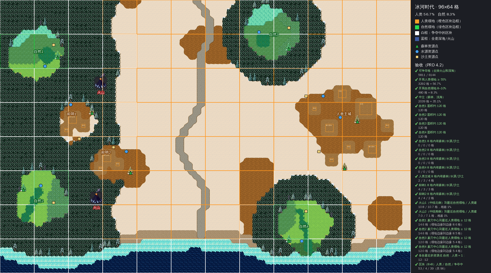

# 生态争夺 · 素材库

《生态争夺》（自然 vs 人类）的像素美术素材库。规范来自《美术方案》：像素风、3/4 斜俯视、32×32 方格；单位做 8 个方向（画 5 个，左侧 3 个由右侧镜像）；1 像素深色描边；光源在左上。

## 网站（Vercel）

素材网站在 `web/`（Vite + PixiJS 纯静态站），部署在 Vercel，生产分支为 `main`。根目录的 `vercel.json` 已配置好构建命令，Vercel 项目的 Root Directory 保持仓库根目录即可。

- **图鉴**（`#/`）：所有已生成素材按同一像素比例并排播放，可切换待机、行走、攻击、休息动作和 8 个方向；下方列出物种表中待生成的物种。
- **素材详情 / 配置**（`#/unit/<id>`）：大图播放器、全部帧、8 方向静态图；物种表中的设定（技能树、捕食、攻击、休眠、寿命等）、生成提示词与参数、动作提示词、来源登记、PNG/JSON 下载、原始 YAML。
- **实验室**（`#/lab`）：默认显示冰河时代的 96×64 固定关卡（可切回旧的演示小图），可勾选「领地与区块」查看归属和 8×8 区块。单位可以自己闲逛、追击并攻击敌对阵营，按物种表的休眠时段休息；也可以强制全体或单个单位进入待机、行走、攻击、休息。另有昼夜色调、百人混战压测、放置和清空。

本地预览：

```bash
cd web && npm install && npm run dev
```

`npm run build` 会先运行 `web/scripts/build-data.mjs`，把 `units/`、`prompts/`、`data/`、`tilesets/` 汇总成 `web/public/data/manifest.json`。所以只要提交了素材，Vercel 下一次部署就会自动展示。

## 目录结构

```
prompts/
  style.yaml               全局风格、默认动作（待机/行走/攻击）、生成的 5 个方向、镜像关系、调色板开关
  units/<id>.yaml          每个物种：表格行、提示词、画布、骨骼模板、种子、栖息地、动作覆盖
  tilesets.yaml            实验室地块（Wang 自动拼接）的提示词
data/
  species.json, creatures.csv  物种表快照（scripts/sync_species.py 拉取）
units/<id>/
  raw/                     PixelLab 原始导出（不改动）
  candidates.png           候选对比图（每个物种生成多个候选，挑最好的）
  <id>.png / <id>.json     处理后的精灵图集 + 图集描述（TexturePacker JSON Hash，Phaser 3 / PixiJS 直接加载）
  source.json              来源登记：工具、日期、候选、选中的 character_id、请求参数、消耗
tilesets/<id>.png|json     4×4 地块图集 + 每块的四角地形（旧的演示小图用）
terrain/                   关卡地块：raw/ 是 PixelLab 原图，ice_age.* 是分层过渡图集
objects/map/               地图物件：火山、资源点、树（<id>/ 下是候选）
maps/                      固定关卡：布局、Tiled 地图、预览、验收清单
web/                       素材网站
scripts/
  pixellab_api.py          PixelLab v2 REST 客户端（API key 只从环境变量读取）
  generate.py              candidates → pick → animate → redo / download
  generate_tilesets.py     生成地块
  postprocess.py           统一画布、镜像出 8 方向、（可选）锁调色板、拼图集、导出 GIF
  sync_species.py          同步物种表
  preview_scene.py         静态预览图（旧，网站实验室已取代）
```

## 生产流程（每个物种）

```bash
export PIXELLAB_API_KEY=pixl_xxx                                   # 不要提交到仓库
python scripts/sync_species.py                                     # 1. 同步物种表
# 2. 新建 prompts/units/<id>.yaml（复制一个现有的改）
python scripts/generate.py candidates prompts/units/<id>.yaml --n 3   # 3. 生成 3 个候选，看 units/<id>/candidates.png
python scripts/generate.py pick prompts/units/<id>.yaml <character_id> # 4. 选定
python scripts/generate.py animate prompts/units/<id>.yaml            # 5. 待机/行走/攻击 × 5 方向（并发）
python scripts/generate.py redo prompts/units/<id>.yaml walk/east     # 6. 不满意的方向单独重做
python scripts/handedit.py build <id>                                 # 7. AI 手改攻击 + 死亡（不耗次数）
python scripts/attack_combo.py <id>                                   # 8. 结合版攻击（默认方向分配见下文）
python scripts/postprocess.py <id>                                    # 9. 处理
```

以上步骤都可以中断后重跑：已完成的方向会跳过，已付费的 AI 关键姿势会复用。

最后在物种表 K 列打勾，提交并推送；Vercel 会自动部署。

## 生成参数与费用（实测，Tier 2）

| 操作 | 接口 | 消耗 |
| --- | --- | --- |
| 新建 8 方向角色（32px 或 64px） | `create-character-v3`，从文字生成 | 2 次 |
| 动画，每个方向 | `characters/animations`，`mode: v3` | 1 次 |
| Wang 地块（32px，pro 模式） | `create-tileset` | 约 20 次/套 |

每个物种的流程：3 个候选（6 次）+ 待机/行走/攻击 × 5 方向（15 次）+ 重做（0～12 次），约 **21～33 次**。表中现有 30 个物种合计约 1000 次，Tier 2 每月 5000 次足够；同时最多跑 10 个任务。

## 第二轮试做（2026-11-09）

每个体型各做一个物种，都已在物种表 K 列打勾。

| 体型 | 物种 | 画布 | 选中的候选 | 重做 | 消耗 |
| --- | --- | --- | --- | --- | --- |
| 微型 | 古代切叶蜂（3～4 只成群当一个单位，飞行） | 32px | seed 4101 | 攻击·上 | 22 次 |
| 小型 | 撒丁岛巨兔 | 32px | seed 4202 | 行走 ×5、攻击 ×5、攻击·上 ×2 | 33 次 |
| 中型 | 剑齿虎 | 32px | seed 4302 | 无 | 21 次 |
| 大型 | 猛犸象（补齐待机和攻击） | 64px | 试用版 | 攻击 ×5 | 22 次（含试用） |

另做了 3 套地块：雪地/苔原、雪地/水域、雪地/泥地。

### 结论

- **候选机制有效。** 同一提示词的 3 个候选差别很大：剑齿虎有一个直接画成了老虎，蜂有一个只画了一只大蜂。先出候选再挑，是保证质量最划算的一步。
- **蜂群可行。** 一张 32px 图里画 3～4 只蜂，8 个方向一致，动起来像一小群；在实验室里作为飞行单位悬浮，可以越过水面。
- **动作描述要写具体，并写清这个方向能看到什么。**
  - 巨兔第一版的行走和攻击几乎不动；改成"身体明显离地""张嘴露出门牙"之后明显好了。
  - 但同一句描述用在背面时，模型会在背上画出一张嘴；给背面单独写"只看得到背和耳朵"就解决了。生成脚本现在支持 `action_by_dir`，可以按方向单独写描述。
- **大型单位的道具容易变形。** 猛犸象第一版攻击时象牙形状一直在变；在描述里要求"象牙每一帧保持同样形状"之后稳定了。
- **还可以再改进的地方。**
  - 巨兔偏圆，比较像仓鼠，可以在描述里强调更长的身体和后腿。
  - 剑齿虎带条纹；化石证据不支持条纹，但游戏里辨识度更高，保留与否由你决定。
  - 剑齿虎在表中是"大型食肉类"，但按《美术方案》的尺寸表我先做成了中型（32px）；如果想让它更大，可以改成 48px 重做。

### 早期试用（试用账号）

原始人猎人和狼是第一轮试用时做的演示单位，不在物种表中，在网站里标为"演示单位"。人类表格定稿后再正式生成人类单位。

## 攻击动画三种版本（2026-11-09 第三轮）

网站的图鉴、详情页和实验室都可以切换"攻击版本"，并开关"攻击节奏优化 / 打击感"做对比。对比动图在 `preview/attack_compare_*.gif`。

| 版本 | 做法 | 覆盖 | 每方向消耗 |
| --- | --- | --- | --- |
| PixelLab 原版 | v3 按文字一次生成 6 帧，匀速播放 | 5 方向 | 1 次 |
| PixelLab 关键帧 | Pixen 编辑出"蓄力""出击"两个关键姿势 → v3 补中间帧 → 按"站立-蓄力(260ms)-出击(50ms×n)-命中(150ms)-收招"重排 | 5 方向 | 3 次 |
| AI 手改 | aseprite-ai-artist 的文本网格方法：在原图上框选头部/前腿移动、挤压拉伸、加残影，节奏按它的 rules/44 | 右、右下 | 0 次 |

- 脚本：`scripts/attack_keyframes.py <unit>`（关键帧，描述写在单位 YAML 的 `attack_keys`），`scripts/handedit.py build <unit>`（手改，配方在 `prompts/handedit/<unit>.py`）。
- 关键帧版的动作幅度最大，最像"攻击"；缺点是中间帧会轻微走样（巨兔伸长时一度长出尾巴、蜂群朝下时合成一只大蜂，已重做）。
- 手改版完全保留原图像素，但只能做位移、挤压和残影，框选移动后会留下少量接缝。
- "攻击节奏优化 / 打击感"是播放代码，对三个版本都生效：每次攻击单独播放，伤害落在命中帧；命中瞬间定格 70～110ms、火花、被击方后退闪白，大型单位震屏。原版没有画出前冲，就在命中帧用代码前冲 4px。

## 法线光照与天气

- 法线贴图用 [Sprite Fusion Sprite Normals](https://github.com/Hugo-Dz/spritefusion-sprite-normals)（MIT，Rust CLI）生成：`cargo install --git https://github.com/Hugo-Dz/spritefusion-sprite-normals --locked`，然后 `python scripts/normals.py`；`postprocess.py` 在装了 CLI 时会自动生成。
  - 单位：`units/<id>/<id>_n.png`，与精灵图集同布局。
  - 地块：`tilesets/<id>_n.png`，逐块处理并关闭轮廓体积，避免每块都变成小金字塔。
- 实验室把颜色世界和法线世界分别渲染到屏幕大小的纹理，再用一个全屏着色器合成：
  - 太阳方向和颜色随时间变化：清晨从东边来的暖光，正午头顶白光，黄昏从西边来的橙光，夜晚月光。
  - 夜里人类单位带火把，营地（泥地中心）有篝火，最多 16 个点光源。
  - 可选"像素风分级光照"（光照量化成 4 级），以及与旧"色调滤镜"对比。
- 天气：晴、小雪、暴风雪（风雪 + 白雾 + 阳光减弱）、雾（抖动像素雾）。天气粒子在屏幕空间绘制，并随环境光变暗。
- 素材详情页可以切换 原图 / 法线光照 / 法线贴图，鼠标移动光源。

## 第四轮：陆地物种批量生产（AI 手改攻击 + 死亡）

**流程（每个物种）**：PixelLab 出 3 个候选 → 挑选（详情页"候选对比"可查看，不满意可换）→ PixelLab 生成待机、行走（各 5 方向）→ `scripts/handedit.py build <id>` 生成 AI 手改的攻击和死亡（5 方向，镜像出 8 方向，0 生成次数）→ `scripts/postprocess.py <id>`（含法线贴图）。

**手改 v2**（`scripts/handedit.py`）
- 自动选区：沿面朝方向取轮廓前半部的上 70% 作为头部，下 30% 作为前肢。像在 Aseprite 里框选移动一样处理，再补缝、清理残留描边。
- 正面（朝镜头）：后仰蓄力，然后放大并下移，表现扑向镜头。背面：下沉蓄力，然后向上拉伸。
- 死亡：后退 → 踉跄 → 腿软 → 倒下 → 着地 → 弹一下 → 静止，倾斜用 RotSprite 式旋转保持像素干净，然后由游戏代码淡出。蜂群改为从空中掉落。
- 单位 YAML 里的 `handedit: {kind: lunge|swarm, heavy, mag}` 控制风格；需要时可在 `prompts/handedit/<id>.py` 手动指定个别方向的选区（巨兔、猛犸象的右、右下用的就是手调选区）。

**体型**：微型 32px（成群）· 小型 32px · 中型 32px · 中大型 48px（剑齿虎）· 大型 64px。

**花纹按真实记录**：化石不保存毛色。剑齿虎、敏捷古猫没有花纹记录，所以用纯色；冰河斑鬣狗在肖维岩洞壁画里有斑点，所以保留斑点。旧的 32px 带条纹剑齿虎存档在 `archive/`。

**候选重做**：乳齿象两轮都像猛犸象（提示词里出现物种名时，模型会往猛犸象靠），第三轮去掉物种名、直接描述外形才分开；剑齿虎第二轮出现狮鬃，第三轮改用猫模板并写明无鬃；披毛犀第一轮没有长毛，重写后解决。

**打击感规范**：见 [`docs/hit-feel.md`](docs/hit-feel.md)。

## 高清标准试点（2026-11）

| 项目 | 旧标准 | 高清标准 |
| --- | --- | --- |
| 地块 | 32px | 64px（PixelLab Pro 地块，`prompts/tilesets_hd.yaml`） |
| 中小型单位 | 32px，v3 | 64px，Pro 角色模式 |
| 大型单位 | 64px | 128px，Pro 角色模式 |
| 道具/建筑 | — | 80–96px，Pro 图像模型（`props/`） |

- **参考图**：`scripts/wiki_refs.py <id>` 从物种表"wiki参考"列的维基百科页面抓取复原图，同时记录授权，存到 `refs/<id>/`。单位 YAML 的 `reference` 指定其中一张，作为 Pro 模式 `create_from_concept` 的概念图。优先选公有领域、CC0 或 CC BY 的图，CC BY-SA 可能带来相同方式共享的义务。维基百科有限流，抓一个物种要几分钟。
- **试点物种**：冰河斑鬣狗（64px，参考图是 2016 年摩尔多瓦邮票上的复原画，公有领域）、猛犸象（128px，参考图是皇家卑诗博物馆的等身模型照片，CC BY 2.0，作者 Thomas Quine）。旧版存档在 `archive/`。
- **手改攻击在高清下改用"变形"**：大画布上框选移动会露出接缝，所以 64px 及以上的单位改用平滑变形：身体前部移动，后部不动，中间连续拉伸，不会撕开。
- **实验室**：默认使用 64px 高清地图（`#/lab/classic` 是旧的 32px 地图），人类营地摆放了道具。移动速度、攻击距离和光照半径都随地块大小缩放。
- **已知问题**：三套地块各自画了一份雪地，相邻处能看到雪的纹理略有不同。批量生产时会让地块共用同一块雪地底图来解决。


## 第六轮：全部物种升级 64px 高清（2026-11-09）

除猛犸象保持 128px 外，19 个物种全部改为 64px、Pro 角色模式重做，旧版移到 `archive/<id>_<旧尺寸>px[_v3]`。

**统一做法**
- **风格统一**：所有物种都以已认可的冰河斑鬣狗作为风格参考（`style_character_id`），每个物种出 2 个候选，人工挑选。
- **描述**：在原英文描述基础上，补充了物种表 M 列（物种描述）里的特征。
- **参考图**：维基百科对本容器的出口 IP 限流非常严重，大部分请求返回 429。抓图脚本已改为慢速逐个请求，并且只下载公有领域、CC0 或 CC BY 授权的图。最终用上概念图的只有巴利阿里山羊（博物馆等身模型照片，公有领域）。大地懒的两张开放授权图都是 19 世纪画得像熊的复原图，没有使用。其余物种用"文字 + 斑鬣狗风格"生成。各物种 YAML 的 `reference` 注释里写了原因；以后把开放授权图放进 `refs/<id>/` 并填入 `reference`，即可重新生成。
- **攻击默认用结合版**（网站默认值也已改为结合版，没有结合版的单位自动回退到 AI 手改版）：
  - 南、东：Pixen 编辑出蓄力、出击两个关键姿势。
  - 东南、东北：从 v3 动画中挑出关键姿势，这样能保持斜角视角。
  - 北（背面）：AI 画出的关键姿势会转成侧身，所以统一使用手改变形版。
  - 蜂群（切叶蜂、熊蜂）：使用手改的蜂群攻击。
- **AI 关键姿势的颜色清理**：AI 画的关键姿势经常带入原图没有的颜色，比如红色轮廓、橙色耳朵、轮廓内一圈浅色描边。现在的规则是：
  - 只有"像嘴"的新颜色（红/粉色的口腔、接近白色的牙齿）才会保留，而且必须是位于头部一端、在轮廓线内部的小块区域。
  - 外轮廓统一改为原图的深色描边。
  - 轮廓内侧的浅色描边会被去掉。
  - 单个单位可以设置 `attack_new_colors: false`，让所有像素都贴回原调色板（大鲵用了这个设置）。
- **AI 关键姿势失败的方向**：在 YAML 里写 `attack_hand_dirs`（附 `attack_hand_why` 说明原因），这些方向改用手改版：
  - 恐鸟：南、东南、东北。鸟类身体被画出了手臂、獠牙或背面。
  - 沼蛙：东南、东北。出现冲击星形和褪色。
  - 湾鳄：东南。两次生成颌部都出现浅色色块。
  - 大地懒：东北。身体被压扁。
  - 部分方向换了种子重新生成，可在对应 `source.json` 里查到：剑齿虎南、大地懒东、大鲵东南和东北。

**费用**：每个物种约 30–39 次（2 个 Pro 候选约 20 次，待机和行走 5 方向共 10 次，结合版关键姿势约 4–6 次）。19 个物种实际合计 672 次（Tier 2 每月 5000 次）。

**已知问题**
- **体型差异**：统一用 64px 画布后，鼠兔、蜂群和洞熊、乳齿象在地图上差不多大。如果要拉开体型差距，有两个办法：(a) 游戏内按体型等级缩放，代价是像素密度不一致；(b) 只给巨型动物用更大画布，像猛犸象那样用 128px。
- **配色**：大地懒的颜色偏橙黄，这是受斑鬣狗风格参考的影响。
- **雪地接缝**：地块之间雪地的接缝问题仍未处理（见上一节）。
- **人类单位**：猎人仍是旧的 32px，在 64px 地图上显得很小，下一批需要一起升级。

## 第七轮：现代时代陆地物种（2026-11-10）

物种表"现代"一栏中的全部陆地物种，按冰河时代同一套流程制作：PixelLab Pro 角色模式，64px，以冰河斑鬣狗为风格参考，每个物种出 2 个候选，人工挑选。攻击用结合版，死亡用手改版。

- **新做 24 个**：菜粉蝶、棕煌蜂鸟、海岛狐蝠、蜜罐蚁、黑色木工蚁、豪勋爵岛竹节虫、欧洲刺猬、小盲鼹鼠、北美白足鼠、欧洲水䶄、野牦牛、野猪、非洲森林象、赤狐、黄鼬、兔狲、猎豹、北美灰狼、科迪亚克棕熊、华南虎、斑鬣狗、变色龙、金色箭毒蛙、苏湾尼鳄龟。配置文件是 `prompts/units/nature_modern_*.yaml`。
- **直接复用冰河时代素材**：现代表中的原生熊峰、湾鳄、大鲵、湖侧褶蛙与冰河时代是同一物种，K 列已勾选，不再重复生成。
- **群体单位**：蝴蝶、两种蚂蚁画成 2–3 只一组，与蜂群一样使用手改的蜂群攻击。
- **候选挑选规则**：PixelLab 有时会把地面投影直接画进精灵图（变色龙、华南虎、白足鼠的其中一个候选），这类候选一律不选。游戏里的阴影由引擎统一绘制。
- **AI 关键姿势失败、改用手改版的方向**（`attack_hand_dirs`）：
  - 森林象：东北，象牙碎块飘在空中。
  - 鳄龟：东北，龟壳被画成钩子形状。
  - 科迪亚克棕熊：东南，长出猫尾巴。
  - 竹节虫：东南，身体被拉成带尾刺的长条。
  - 盲鼹鼠：东北，像人一样跳起来。
  - 狐蝠：东南，坐到了地上。
  - 蜂鸟：南，翻身露出背面。
  - 华南虎：南，爪子变成白色色块。
  - 斑鬣狗：南和东北，正面变成背面，斜向有飞溅的碎屑。
  - 野猪：南和东，獠牙被画成卷曲的羊角。
  - 野牦牛：东北，像猫一样跃起，还多了一条长尾巴。
- **工具改进**：
  - 手改清理过去会把 1–4 像素的斑点当成残留轮廓线涂掉，猎豹的斑点因此丢失。现在只清理较长的深色线段。冰河斑鬣狗和沼蛙已按新规则重建。
  - 新增单位级配置 `lock_palette`：待机和行走帧的颜色贴回该单位旋转图的调色板，用来解决 v3 帧间颜色漂移（蜜罐蚁的蜜囊忽浅忽深）。
  - 蜂鸟的正面和东面行走重新生成过一次，去掉了多余的白色残影。
  - 流程中断后可以直接续跑：已经在 PixelLab 上生成的方向会被识别为完成，不会重复扣次数。
- **费用**：24 个物种合计 839 次 PixelLab 生成（含少量重做），每个约 30–38 次。

## 3D 路线试验（Tripo，未采用）

做法和结论见 `experiments/3d-tripo/README.md`。用户决定暂不使用 3D 模型，继续用 PixelLab 加 AI 手改的流程。

## 第五轮：冰河时代地图（初版，2026-11-09）

按 PRD 第 4 节（地图与领地）和 5.1 节（领地地块）做的第一版地图资源，用了 179 次生成。



### 产出

| 文件 | 内容 |
| --- | --- |
| `terrain/ice_age.png` / `.json` / `.tsj` | 15 种地块的分层图集：每行一种地块，第 0–15 列是 16 种边缘（按四角掩码），第 15–18 列是 4 张整格变体。另有法线贴图 `_n.png` 和 Tiled 图块集 `.tsj` |
| `terrain/ice_age_decals.png` | 侵蚀（自然吃人类格）和开垦（人类吃自然格）贴花：13 种转化，每种 33%、66% 两档 × 2 个变体 |
| `objects/map/*.png` + `objects.json` | 火山（3×3）、森林/水源/沙土资源点、云杉 ×2、松树、枯树；`objects.json` 记录占地、锚点和来源 |
| `maps/ice_age_layout.json` | 关卡布局（每格地形 + 物件），是可编辑的源文件 |
| `maps/ice_age.tmj` | Tiled 地图，图块集已内嵌，Phaser 3 用 `this.load.tilemapTiledJSON` 直接加载 |
| `maps/ice_age_preview.png` | 原尺寸渲染（3072×2048） |
| `maps/ice_age_overview.png` | 总览：领地着色、区块边框、资源点、验收结果 |
| `maps/ice_age_check.md` | PRD 4.2 验收清单（24 项全部通过） |

### 地块（PRD 5.1）

| 层级 | 地块 | 归属 | 转化耐久 → 变成 |
| --- | --- | --- | --- |
| 0 | 深海 `x_deep` | 中立（不可争夺） | — |
| 1 | 浅海 `x_shallow` | 中立 | 待定 |
| 2 | 杂乱有植物与淤泥的溪流 `n_stream` | 自然 | 100 → 石块围堰的规整溪流 |
| 3 | 碎石河滩 `h_shore` | 人类 | 60 → 各色石子与海藻的海滩 |
| 4 | 各色石子与海藻的海滩 `n_beach` | 自然 | 80 → 碎石河滩 |
| 5 | 踩平的泥地 `h_mud` | 人类 | 60 → 猛犸草原 |
| 6 | 夷土营地 `h_camp` | 人类 | 100 → 不规则的石子坡 |
| 7 | 清扫过的雪地 `h_snow` | 人类 | 40 → 冻原苔原 |
| 8 | 冻原苔原 `n_tundra` | 自然 | 80 → 踩平的泥地 |
| 9 | 猛犸草原 `n_steppe` | 自然 | 60 → 踩平的泥地 |
| 10 | 火山岩地 `x_basalt`（火山脚下） | 火山（不可争夺） | — |
| 11 | 不规则的石子坡 `n_rocks` | 自然 | 120 → 夷土营地 |
| 12 | 石块围堰的规整溪流 `h_weir` | 人类 | 120 → 杂乱溪流 |
| 13 | 冰川 `n_glacier` | 自然 | 200 → 清扫过的雪地 |
| 14 | 极度茂密的森林 `x_forest` | 中立 | 2 倍；自然渗透 → 冻原苔原，人类伐木 → 踩平的泥地（建议） |

### 做法

- **底图（PixelLab）**：`create-tileset`（pro、32px、低俯视）一套出两种地块，只取「四角全是同一种」的两块，它们天然无缝平铺。8 套，每套约 15 次。
  - 杂乱溪流画了三次：前两次分别画成了草地和深色苔藓，第三次在描述开头强调「深青色水面」才像水。旧版存档在 `archive/terrain/`。
  - 试过 `create-tiles-pro`，出来的是带厚度的方块砖，不适合做平铺地面，没有采用。
- **过渡（脚本生成，0 次）**：采用 dual grid（显示网格错开半格）加分层叠加，这是 Townscaper 和很多 RTS 地形混合的做法。
  - 逻辑上每格只有一种地块。每个显示块读周围 4 格，先画层级最低的地块，再按层级依次叠上更高的地块，最多 4 层。
  - 所以任意两种地块都能相邻；一格翻转时，只需重画它周围 4 个显示块。算法在 `scripts/terrainlib.py`，网站里的 TypeScript 版本在 `web/src/level.ts`。
  - 每种地块的 16 种边缘由脚本生成：人类地块边缘规整，自然地块参差；围堰溪流加石块描边；石坡、冰川、森林加凸起高光和 3/4 投影（光从左上）。
  - 自然地块的层级普遍高于人类地块，所以交界处是自然的参差边缘压在人类的规整地面上。
- **贴花（脚本生成）**：用「将要变成的地块」的纹理长出斑块（33% 约 20%，66% 约 48%），玩家能提前看出这一格会变成什么。
- **物件（PixelLab `/map-objects`）**：每种 2–3 个候选，挑一个。火山选了熔岩最醒目、山脚有雪的那个。
- **关卡（脚本）**：`scripts/build_map.py layout` 用固定种子生成布局，`build` 自动拼接、导出 Tiled、出预览，并逐条检查 PRD 4.2 的验收清单。

```bash
export PIXELLAB_API_KEY=pixl_xxx                       # 不要提交到仓库
python scripts/generate_terrain.py                      # 地块底图（已有的跳过）
python scripts/build_terrain_atlas.py                   # 分层图集 + 贴花
python scripts/generate_map_objects.py candidates       # 物件候选 → objects/map/<id>/candidates.png
python scripts/generate_map_objects.py pick volcano 6202
python scripts/build_map.py layout                      # 只在想重新生成布局时运行（会覆盖手改）
python scripts/build_map.py build                       # 改了布局或图集后运行
```

### 布局与验收

- 布局按 PRD 4.2 示意图：
  - 人类主城占中部和东部，西侧森林里有 2 个前哨。
  - 4 块自然开局领地各 120 格：西北偏冰川，西南有石坡和溪流，北部中央有冰川和石坡，南部海岸有海滩和入海溪流。
  - 2 座火山在中线南北两侧；南边是海。
- 结果：人类 56.7%，自然 8.3%，中立 35%。
  - 每块开局领地和每个人类据点 8 格内都有森林、水源、沙土资源点。
  - 两座火山到最近自然领地和最近人类建筑的距离相差约 1%。
  - 最近资源点数量自然 : 人类 = 12 : 12。
- 人类开局建筑（岩洞、篝火营地、石屋、兽皮帐篷）只放了占地框，还没有美术。

### 需要你确认

1. **12 格安全距离怎么量**：目前按「巢穴中心到最近人类格 ≥ 12 格」算，边缘到边缘约 5–9 格。若要求边缘到边缘 12 格，人类最多只能占约 43%，和「≥ 55%」冲突，二者需要取舍。
2. **浅海**：PRD 只把火山和深海排除在可争夺格之外，所以浅海现在算中立、可争夺，但没有任何一方能转化它。可以改成不可争夺，或者给它定转化规则（例如自然靠海藻林渗透）。
3. **森林被转化后变成什么**：PRD 没写，暂定自然渗透 → 冻原苔原，人类伐木 → 踩平的泥地。
4. **单格资源点的大小**：资源点现在占 1 格；森林资源点的画面是 48×64，比格子大，方便点击。
5. 下一步可以做：现代地块（13 种），人类建筑，火山烟雾和水面动画，以及在 Tiled 里手调布局后重新 `build`。
