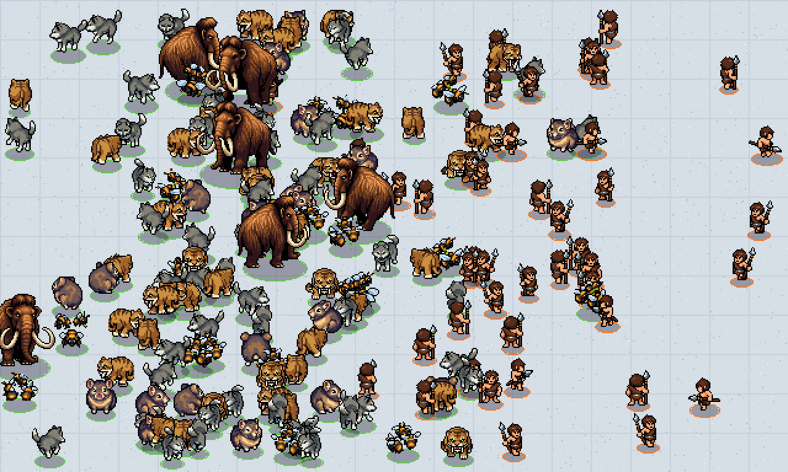
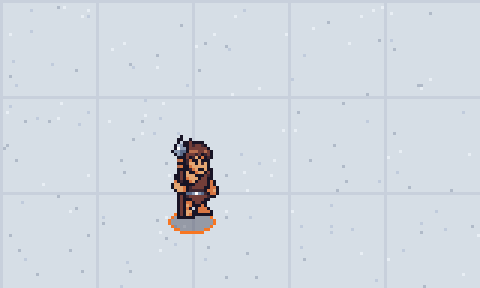
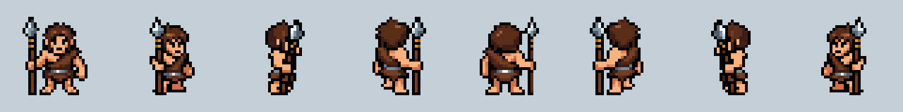
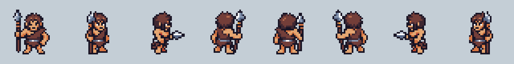
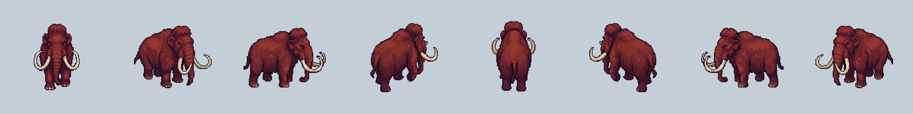
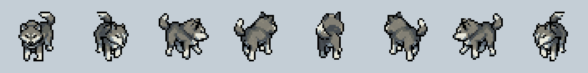

# 生态争夺 · 素材库

《生态争夺》（自然 vs 人类）的像素美术素材库。规范来自《美术方案》：像素风、3/4 斜俯视、32×32 方格；单位做 8 个方向（画 5 个，左侧 3 个由右侧镜像）；1 像素深色描边；光源在左上。

## 网站（Vercel）

素材网站在 `web/`（Vite + PixiJS 纯静态站），部署在 Vercel，生产分支为 `main`。根目录的 `vercel.json` 已配置好构建命令，Vercel 项目的 Root Directory 保持仓库根目录即可。

- **图鉴**（`#/`）：所有已生成素材按同一像素比例并排播放，可切换待机、行走、攻击、休息动作和 8 个方向；下方列出物种表中待生成的物种。
- **素材详情 / 配置**（`#/unit/<id>`）：大图播放器、全部帧、8 方向静态图；物种表中的设定（技能树、捕食、攻击、休眠、寿命等）、生成提示词与参数、动作提示词、来源登记、PNG/JSON 下载、原始 YAML。
- **实验室**（`#/lab`）：用 PixelLab 生成的自动拼接地块（雪地、苔原、水域、泥地）拼出地图。单位可以自己闲逛、追击并攻击敌对阵营，按物种表的休眠时段休息；也可以强制全体或单个单位进入待机、行走、攻击、休息。另有昼夜色调、百人混战压测、放置和清空。

本地预览：

```bash
cd web && npm install && npm run dev
```

`npm run build` 会先运行 `web/scripts/build-data.mjs`，把 `units/`、`prompts/`、`data/`、`tilesets/` 汇总成 `web/public/data/manifest.json`。所以只要提交了素材，Vercel 下一次部署就会自动展示。

## 目录结构

```
prompts/
  style.yaml               全局风格、默认动作（待机/行走/攻击）、生成的 5 个方向、镜像关系、调色板开关
  units/<id>.yaml          每个物种：表格行、提示词、画布、骨骼模板、种子、栖息地、动作覆盖
  tilesets.yaml            实验室地块（Wang 自动拼接）的提示词
data/
  species.json, creatures.csv  物种表快照（scripts/sync_species.py 拉取）
units/<id>/
  raw/                     PixelLab 原始导出（不改动）
  candidates.png           候选对比图（每个物种生成多个候选，挑最好的）
  <id>.png / <id>.json     处理后的精灵图集 + 图集描述（TexturePacker JSON Hash，Phaser 3 / PixiJS 直接加载）
  source.json              来源登记：工具、日期、候选、选中的 character_id、请求参数、消耗
tilesets/<id>.png|json     4×4 地块图集 + 每块的四角地形
web/                       素材网站
scripts/
  pixellab_api.py          PixelLab v2 REST 客户端（API key 只从环境变量读取）
  generate.py              candidates → pick → animate → redo / download
  generate_tilesets.py     生成地块
  postprocess.py           统一画布、镜像出 8 方向、（可选）锁调色板、拼图集、导出 GIF
  sync_species.py          同步物种表
  preview_scene.py         静态预览图（旧，网站实验室已取代）
```

## 生产流程（每个物种）

```bash
export PIXELLAB_API_KEY=pixl_xxx                                   # 不要提交到仓库
python scripts/sync_species.py                                     # 1. 同步物种表
# 2. 新建 prompts/units/<id>.yaml（复制一个现有的改）
python scripts/generate.py candidates prompts/units/<id>.yaml --n 3   # 3. 生成 3 个候选，看 units/<id>/candidates.png
python scripts/generate.py pick prompts/units/<id>.yaml <character_id> # 4. 选定
python scripts/generate.py animate prompts/units/<id>.yaml            # 5. 待机/行走/攻击 × 5 方向（并发）
python scripts/generate.py redo prompts/units/<id>.yaml walk/east     # 6. 不满意的方向单独重做
python scripts/postprocess.py <id>                                    # 7. 处理
```

最后在物种表 K 列打勾，提交并推送；Vercel 会自动部署。

## 生成参数与费用（实测）

| 操作 | 接口 | 消耗 |
| --- | --- | --- |
| 新建 8 方向角色（32px 或 64px） | `create-character-v3`，从文字生成 | 2 次 |
| 动画，每个方向 | `characters/animations`，`mode: v3` | 1 次 |

一个物种 = 建角色 2 次 + 5 个动作 × 5 个方向 × 1 次 = **约 27 次**。与《美术方案》的估算一致：36 个物种约 970 次，加上一倍重试约 2000 次。

## 试用结果（2026-11-09，PixelLab 试用账号）

共用 27 次生成（试用额度 40 次，剩 13 次）。

| 单位 | 画布 | 内容 | 消耗 |
| --- | --- | --- | --- |
| 原始人猎人 `human_ice_hunter` | 32px | 8 方向、走路 ×5 方向、攻击（刺矛）×5 方向 | 12 次 |
| 猛犸象 `nature_ice_mammoth` | 64px | 8 方向、走路 ×5 方向 | 7 次 |
| 狼 `nature_ice_wolf` | 32px | 8 方向、走路 ×5 方向 | 7 次 |
| 对比测试：骨骼模板走路 | — | 猎人朝东，1 个方向（已删除） | 1 次 |

### 百人同屏模拟（2 倍显示，阵营圈和阴影由代码绘制）



### 比例对照（32px 格子，3 倍显示）



### 动画（8 个方向，从左到右：下、右下、右、右上、上、左上、左、左下；左侧 3 个是镜像）






### 结论

- **转向图（8 方向静态）质量高。** 1px 黑描边、左上光源、各方向身份一致，32px 下轮廓清楚。猛犸象 64px 效果最好。
- **v3 文字动画：大体可用，但需要筛选。** 猛犸象走路很有重量感。猎人攻击很清楚。猎人朝东走路时矛从竖着慢慢变成平端，循环会跳帧；朝下走路腿部动作偏小。狼 32px 的右下方向偏糊，像哈士奇多于狼。
- **骨骼模板动画（`template` 模式）不能用。** 它丢掉了角色特征：矛和描边都没了，脸也变了。所以统一用 v3。
- **调色板锁定暂时关闭。** Endesga 32 只是占位，会把灰狼变蓝、肤色变粉（见 `preview/palette_compare.png`，上排原图，下排锁色后）。定调阶段选好真正的主调色板后，在 `prompts/style.yaml` 打开即可。
- **免费账号同时只能跑 1 个任务，每个约 3～4 分钟。** 订阅后可以并发，批量生产时会快很多。

### 批量生产时的改进点

1. 动作描述写得更具体，并约束道具姿态（如 “spear stays vertical”），每个动作多生成一版挑选。
2. 小型四足动物考虑用 40～48px 生成，或者先精修朝下的那张作为参考图，再用参考图模式转 8 方向。
3. 定调图确定后，用 `create-character-pro` 的 `style_character_id` 把它作为风格参考（每个角色 10～25 次，较贵），或继续用 v3 加统一的提示词模板。
